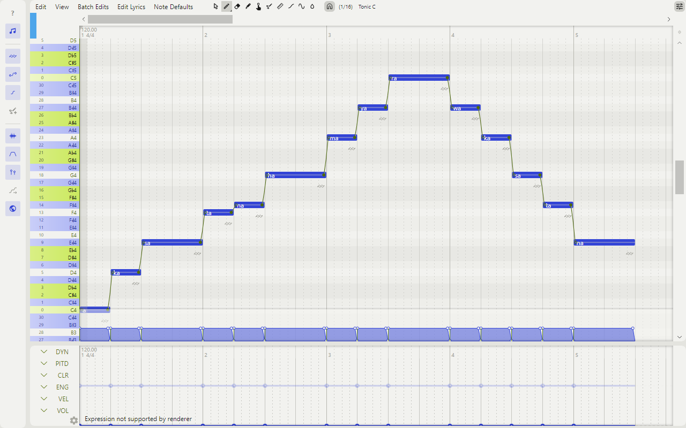
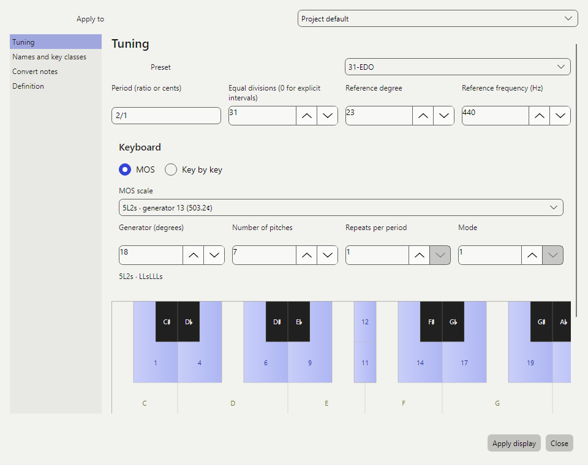
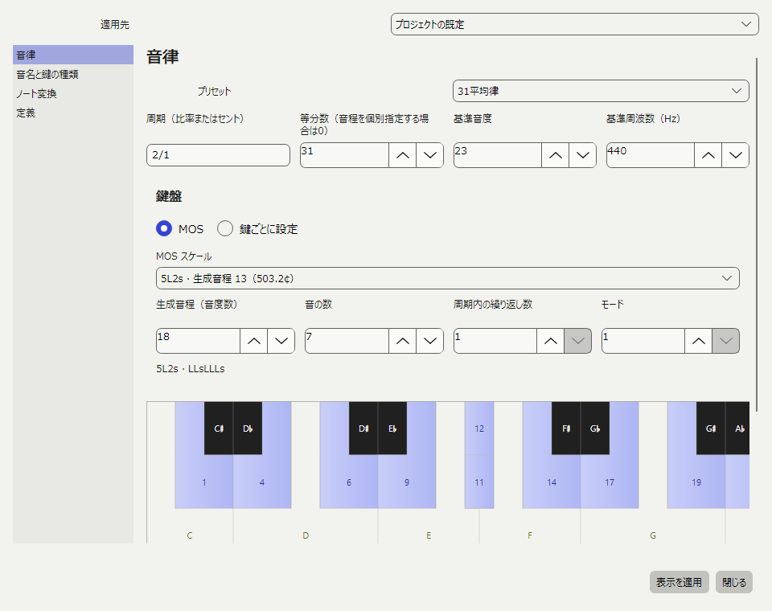

# OpenUtau Xen

**[English](#english)** | **[日本語](#japanese)**

<a id="english"></a>

## English

OpenUtau Xen is a fork of [OpenUtau](https://github.com/stakira/OpenUtau) for
microtonal and multi-tuning singing synthesis. Notes keep their exact pitch in any
tuning, from 12-EDO to 31-EDO, just intonation or non-octave scales, and every
renderer receives that pitch. Xen is still on `0.x`; the plan for the first release
is in [`docs/microtonal/PLAN.md`](docs/microtonal/PLAN.md).



Download the latest version for Windows, macOS or Linux from
[Releases](https://github.com/palf-gh/OpenUtau-Xen/releases/latest). What each
version contains is recorded in [`PRODUCTION.md`](docs/microtonal/PRODUCTION.md).
For general use of the editor (voicebanks, phonemisers, resamplers), see the
[OpenUtau wiki](https://github.com/stakira/OpenUtau/wiki/Getting-Started).

### What Xen adds to OpenUtau

#### Tunings



- Any equal division of any period (EDO, equal divisions of the tritave and other
  periods), and explicit tunings written as exact ratios or cents.
- Presets include equal divisions from 5- to 72-EDO; Pythagorean; 5- and 7-limit just intonation; quarter-,
  third-, sixth- and two-sevenths-comma meantone; Werckmeister III, Kirnberger III,
  Vallotti and Young II; 13-EDT and just Bohlen–Pierce; harmonic series 8–16;
  22 śruti; Partch 43; Carlos Alpha, Beta and Gamma; and sourced regional examples
  (maqam Rast, Turkish AEU, slendro and pelog).
- A reference degree and frequency, such as A4 at 440, 442, 432 or 415 Hz.
- Set the project tuning in **Project → Project tuning** or from the top bar, and a
  track's own tuning in the piano roll's **Edit → Tuning**. Changes stay in the
  dialog until you apply them, and one undo reverts them.
- Applying a new tuning moves each note to its nearest degree. Changing only the
  reference keeps the degrees. An option keeps the old frequencies instead, as a
  degree plus residual cents.

#### Keyboard, scales and note names

- The keyboard is built from a MOS (moment of symmetry) scale of the tuning: its
  notes are white keys, their sharps and flats are black keys, and the steps between
  them are in-between keys. A MOS can repeat within the period (12-EDO diminished
  4L4s, 22-EDO pajara 2L8s). Keys can also be set one by one.
- The **MOS scale** list offers every MOS that holds in the tuning, grouped by note
  count. Only Rothenberg-proper MOS are listed unless **Preferences → Editing →
  Show improper MOS in the tuning MOS list** is on.
- The scale (a tonic and its notes) is set separately from the keyboard. Presets
  include the church modes, Japanese scales such as miyako-bushi and ritsu, Arabic
  maqamat and the Lambda mode of Bohlen–Pierce. The piano roll can show all pitches,
  highlight the scale or show only the scale rows.
- Key labels use Stein–Zimmermann–Gould accidentals where a verified table exists,
  Ups and Downs for other octave equal divisions, Bohlen–Pierce Lambda names for
  equal divisions of the tritave and letters for other MOS keyboards. The piano
  roll's **View** menu chooses the primary and secondary labels.
- The note **Tone** field accepts a natural plus or minus steps (53-EDO `C4+4`,
  `D4-4`), spelled names such as `C#4` or `Db4`, and relative steps such as `+3`.

#### Pitch, rendering and files

- A note stores its degree, residual cents and spelling. The integer MIDI number
  is kept only for phonemisers and sample selection.
- Classic resamplers, WORLDLINE-R, DiffSinger, VOICEVOX, ENUNU and Vogen receive
  the continuous pitch once, and render caches take it into account.
- `.ustxen` projects embed their complete tunings; `.tunxen` stores reusable
  tunings with their keyboard, scale and names. Scala `.scl` and `.kbm` can be
  imported and exported. Upstream `.ustx` files open, and by default saving them
  creates a separate `.ustxen` project. **File → Export Project → Export
  compatible USTX** writes a separate `.ustx` and reports what is lost or rounded.
- On Windows, **Edit → MIDI input** in the piano roll records from a MIDI keyboard
  through the tuning's key mapping, with preview and sustain.

#### Editing

- The workspace layout follows [OpenUtau Lunai](https://github.com/keirokeer/OpenUtau-lunai):
  a welcome screen, a docked piano roll, a top bar and a side toolbar.
- The snap menu separates note values from dotted notes and triplets, quintuplets
  and septuplets.
- Parts and notes are created by dragging, so a stray click adds nothing. `S` splits
  notes at the playhead.
- **Batch Edits → JOB Plugins** runs VOCALOID JOB plugins (Lua scripts) from folders
  added in **Preferences**, in a restricted sandbox.
- Xen's interface is translated into all 20 languages that upstream registers.

### Build and tests

Requires .NET 10 and the existing upstream native runtime dependencies.

```powershell
dotnet build OpenUtau.sln -m:1
dotnet test OpenUtau.Test -m:1
dotnet publish OpenUtau/OpenUtau.csproj -c Release -r win-x64 --self-contained true -m:1
```

External voice tests are opt-in and need the documented local voicebanks. Run them
serially, after the ordinary tests:

```powershell
pwsh -NoProfile -File tools/verify-xen-voices.ps1 -ClassicBank '<UTAU voicebank>' -DiffSingerBank '<DiffSinger configs>' -DiffSingerVocoder '<vocoder.onnx>' -UtauEngine '<folder with resampler.exe>'
```

The synthesis smoke checks use the supplied Classic and DiffSinger assets
without redistributing or modifying their original banks. See
[`voice-smoke.md`](docs/microtonal/voice-smoke.md) for the method and results.

### Verification status

The automated tests cover the tuning model, formats, keyboards, renderer pitch
input and the main dialogs. Classic, WORLDLINE-R and DiffSinger have been checked
with real voices: rendered tones are within 0.75 cent of the requested pitch.
ENUNU, Vogen and VOICEVOX synthesis, real MIDI hardware, and broader interface and
high-DPI review are still open. See the
[production record](docs/microtonal/PRODUCTION.md) for details.

### Contributing

- Work happens on `develop`. Create `feature/<topic>` or `fix/<topic>` from it and
  open a pull request into `develop` (not the default `main`). The pull-request
  tests must pass.
- `main` is the default branch and always points to the latest released version
  (`vX.Y.Z` tags); use it to try a stable state.
- Build and test serially with the commands above. Follow `AGENTS.md` for writing,
  versioning and code conventions, and `DESIGN.md` for colours.
- Japanese documents are checked with the yomiyasu skill before merging. If you do
  not have it, mention the Japanese changes in your pull request.

### Attribution

Upstream code remains under its original MIT licence. The workspace layout
(welcome screen, docked piano roll, top bar and side toolbar) and pitch follow are
reimplemented from [OpenUtau Lunai](https://github.com/keirokeer/OpenUtau-lunai)
(MIT, commit `01be298`). Accidentals use Xen Accidentals, a Modified Version of
Bravura Text under SIL OFL 1.1, renamed because "Bravura" is a Reserved Font Name.
It keeps only the accidental glyphs, rescaled to sit on the baseline, and its
licence is in `OpenUtau/Assets/Fonts/`. `tools/build-xen-accidentals.py` builds it
from the unmodified Bravura Text in `tools/fonts/`, retrieved from Steinberg's
Bravura repository. Voicebanks, external
resamplers and their licences remain separate from this repository and package.
Xen's app data, installer identity and `.ustxen` association are distinct from
upstream OpenUtau; automatic upstream updates are disabled for this derivative.

<a id="japanese"></a>

## 日本語

**[English](#english)** | **[日本語](#japanese)**

OpenUtau Xen は [OpenUtau](https://github.com/stakira/OpenUtau) から派生した、
微分音と多様な音律で歌声合成をするためのエディターです。12 平均律から 31 平均律、
純正律、オクターブで繰り返さない音律まで、どの音律でもノートは正確な音高を保ち、
どのレンダラーにもその音高が渡ります。Xen はまだ `0.x` で、初版までの計画は
[`docs/microtonal/PLAN.md`](docs/microtonal/PLAN.md) にあります。


Windows・macOS・Linux 向けの最新版は
[Releases](https://github.com/palf-gh/OpenUtau-Xen/releases/latest) からダウンロードできます。
各バージョンの内容は [`PRODUCTION.md`](docs/microtonal/PRODUCTION.md) に記録しています。
音源、フォニマイザ、リサンプラーなど、エディターの一般的な使い方は
[OpenUtau の Wiki](https://github.com/stakira/OpenUtau/wiki/Getting-Started) を見てください。

### OpenUtau に追加した機能

#### 音律



- 任意の周期を任意の数で等分した音律（平均律、トリターブの等分など）と、正確な比率や
  セントで書いた音律を使えます。
- プリセットには5〜72 平均律の中のいくつかの平均律、ピタゴラス音律、5 リミットと 7 リミットの純正律、
  1/4・1/3・1/6・2/7 コンマのミーントーン、ヴェルクマイスター III、キルンベルガー III、
  ヴァロッティ、ヤング II、13 等分トリターブと純正のボーレン＝ピアース、倍音列 8〜16、
  22 シュルティ、パーチの 43 音、カルロスのアルファ・ベータ・ガンマ、出典を確かめた
  各地の例（マカーム・ラスト、トルコの AEU、スレンドロ、ペロッグ）があります。
- 基準の音度と周波数を決められます。たとえば A4 を 440・442・432・415 Hz にできます。
- プロジェクトの音律は **プロジェクト → プロジェクトの音律設定** か上部バーから、
  トラックごとの音律はピアノロールの **編集 → 音律設定** から設定します。変更は
  適用するまでダイアログの中だけにとどまり、適用したあとも 1 回の取り消しで戻せます。
- 新しい音律を適用すると、各ノートを最も近い音度に移します。基準だけを変えるときは
  音度を保ちます。元の周波数を保つ選択肢では、音度と残差セントで表します。

#### 鍵盤、音階、音名

- 鍵盤はその音律の MOS（moment of symmetry）音階から作ります。MOS の音を白鍵、
  そのシャープとフラットを黒鍵、その間の音を中間鍵にします。周期の中で繰り返す MOS
  （12 平均律の 4L4s、22 平均律の 2L8s など）も使えます。鍵を 1 つずつ設定することも
  できます。
- **MOS スケール** の一覧にはその音律で成り立つ MOS を音の数ごとに並べます。
  **設定 → 編集** で真正でない MOS の表示をオンにしない限り、Rothenberg の意味で
  真正な MOS だけを出します。
- 音階（主音とその音）は鍵盤とは別に設定します。教会旋法、都節や律などの日本の音階、
  アラブのマカーム、ボーレン＝ピアースの Lambda などのプリセットがあります。
  ピアノロールではすべての音を表示するか、音階を強調するか、音階の行だけを表示するかを
  選べます。
- 鍵の音名には、検証済みの対応表がある音律では Stein–Zimmermann–Gould の変化記号を、
  ほかのオクターブ平均律では Ups and Downs を、トリターブの等分では Bohlen–Pierce の
  Lambda 音名を、それ以外の MOS 鍵盤では文字の音名を使います。主表記と副表記は
  ピアノロールの **表示** メニューで選びます。
- ノートの **Tone** 欄には幹音に段数を足し引きした形（53 平均律の `C4+4`、`D4-4`）、
  `C#4` や `Db4` のような音名、`+3` のような相対的な段数を入力できます。

#### 音高、レンダリング、ファイル

- ノートは音度、残差セント、綴りを保存します。整数の MIDI ノート番号は
  フォニマイザと音素の選択のためにだけ使います。
- Classic のリサンプラー、WORLDLINE-R、DiffSinger、VOICEVOX、ENUNU、Vogen には、
  連続した音高を 1 回だけ渡します。レンダーキャッシュもこの音高を区別します。
- `.ustxen` のプロジェクトは音律の定義をすべて埋め込みます。`.tunxen` は、鍵盤・音階・
  音名を含めた音律を再利用するためのファイルです。Scala の `.scl` と `.kbm` を
  読み込み、書き出せます。本家の `.ustx` も開けます。保存するときは、既定では別の
  `.ustxen` プロジェクトにします。**ファイル → プロジェクトファイルをエクスポート →
  互換USTXを書き出す** は別の `.ustx` に書き出し、失われる情報と丸めた量を知らせます。
- Windows ではピアノロールの **編集 → MIDI入力** で、音律の鍵盤の割り当てに従って
  MIDI 鍵盤から録音できます。試聴とサステインにも対応しています。

#### 編集

- ワークスペースの画面は [OpenUtau Lunai](https://github.com/keirokeer/OpenUtau-lunai)
  にならい、ウェルカム画面、組み込みのピアノロール、上部バー、縦ツールバーで
  構成しています。
- スナップのメニューでは音価を、付点や 3 連符・5 連符・7 連符とは別に選べます。
- パートとノートはドラッグで作るので、うっかりクリックしても何も追加されません。
  `S` キーで再生位置のノートを分割します。
- **一括編集 → JOBプラグイン** で、**設定** で追加したフォルダーの VOCALOID 用
  JOB プラグイン（Lua スクリプト）を、機能を制限した環境で実行します。
- Xen の画面は、本家が登録している 20 言語すべてに翻訳しています。

### ビルドとテスト

.NET 10 と、本家と同じネイティブ実行時依存が必要です。

```powershell
dotnet build OpenUtau.sln -m:1
dotnet test OpenUtau.Test -m:1
dotnet publish OpenUtau/OpenUtau.csproj -c Release -r win-x64 --self-contained true -m:1
```

外部音源を使うテストは任意実行で、記録済みのローカル音源が必要です。通常のテストの後に、
単独で実行してください。

```powershell
pwsh -NoProfile -File tools/verify-xen-voices.ps1 -ClassicBank '<UTAU voicebank>' -DiffSingerBank '<DiffSinger configs>' -DiffSingerVocoder '<vocoder.onnx>' -UtauEngine '<folder with resampler.exe>'
```

この合成スモークテストは提供された Classic と DiffSinger の音源を使います。元の音源は
変更も再配布もしません。手法と結果は [`voice-smoke.md`](docs/microtonal/voice-smoke.md)
にあります。

### 検証状況

自動テストは音律のモデル、ファイル形式、鍵盤、レンダラーに渡す音高、主なダイアログを
確かめています。Classic・WORLDLINE-R・DiffSinger は実際の音源で確かめ、合成した音は
指定した音高との差が 0.75 セント以内でした。ENUNU・Vogen・VOICEVOX での合成、実機の
MIDI 鍵盤、より広い画面と高 DPI の確認はまだです。詳細は
[制作記録](docs/microtonal/PRODUCTION.md) を参照してください。

### 開発に参加するには

- 開発は `develop` で行います。ここから `feature/<内容>` か `fix/<内容>` のブランチを作り、
  `develop` へのプルリクエストを送ってください（既定の `main` ではありません）。
  プルリクエストのテストが通る必要があります。
- `main` は既定ブランチで、常に最新の公開バージョン（`vX.Y.Z` タグ）を指します。
  安定した状態を試すときは `main` を使ってください。
- ビルドとテストは、上のコマンドで 1 つずつ順に実行してください。文章、バージョン、コードの
  決まりは `AGENTS.md` に、配色は `DESIGN.md` にあります。
- 日本語の文書はマージの前に yomiyasu スキルで確認します。yomiyasu を使えない場合は、
  日本語を変更したことをプルリクエストに書いてください。

### 帰属表示

本家のコードは元の MIT ライセンスのままです。ワークスペースの画面（ウェルカム画面、
組み込みのピアノロール、上部バー、縦ツールバー）とピッチ追従は、
[OpenUtau Lunai](https://github.com/keirokeer/OpenUtau-lunai)（MIT、コミット `01be298`）を
参考に作り直したものです。変化記号には Xen Accidentals を使います。これは Bravura Text を
SIL OFL 1.1 に基づいて改変したフォントで、「Bravura」が予約フォント名のため名前を変えています。
変化記号の字形だけを残し、大きさと位置を直してベースラインに乗るようにしました。ライセンスは
`OpenUtau/Assets/Fonts/` に置いています。`tools/build-xen-accidentals.py` が、`tools/fonts/` にある
無改変の Bravura Text からこのフォントを作ります。Bravura Text は Steinberg の Bravura
リポジトリから取得しました。音源、外部リサンプラーとそれらの
ライセンスは、このリポジトリと配布物には含めません。Xen のアプリデータ、インストーラーの
識別情報、`.ustxen` の関連付けは本家 OpenUtau と分けています。この派生版では本家への
自動更新を無効にしています。
